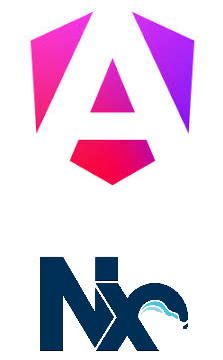
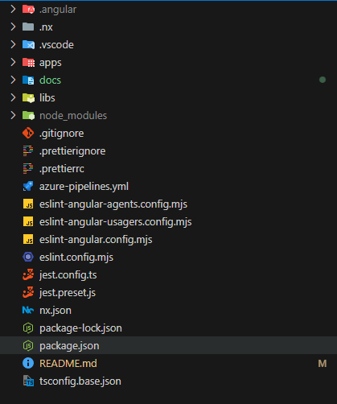
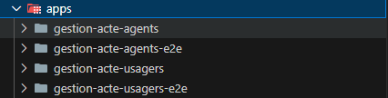
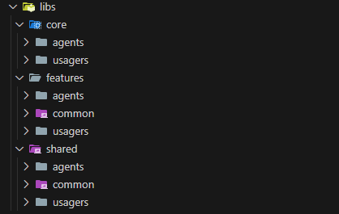
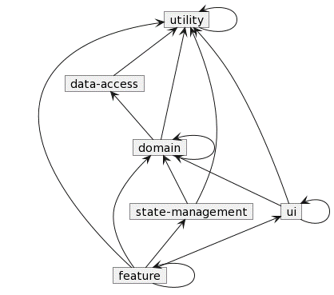

# Angular monorepo - Baseline

# Développement

Lancer l'application (TODO)

# Liens utiles
- Angular : https://angular.dev/
- Nx : Une introduction à Nx https://nx.dev/getting-started/intro
- Store : https://opensource.salesforce.com/akita/
- PrimeNg : https://primeng.org/

# Introduction
L’architecture choisie pour la partie Front de l’application est conçue autour d’Angular (v20) et adopte une structure s’articulant autour d’un workspace Nx structurant un monorepo. Ce choix, outre qu’il semble être une des meilleures options techniques à cette heure, permet de décomposer l’application en sous-parties de tailles variables ayant un minimum de dépendances entre elles pour une meilleure réutilisabilité et une maintenance simplifiée. Un workspace Nx étant agnostique des technologies utilisées, cette organisation permet aussi d’enrichir l’application avec des briques construites à l’aide d’autres Frameworks (React.js, Vue.js, etc..), voire simplement en javascript/html tout en gardant exactement la même structure et les mêmes pratiques de développement. Cette organisation, de type monorepo, donnera aussi l’opportunité, si le besoin se manifeste, d’écrire d’autres applications liées ou totalement indépendantes au sein du même workspace, en réutilisant les briques logicielles qui sont organisées sous formes de librairies.

# Stack Technique
## Présentation
Nx est un outil de gestion de structure de projet s’organisant autour d’une architecture monorepo. Cela permet d’organiser une solution Angular autour d’un workspace composé de plusieurs projets / librairies dans le but de découpler les différentes préoccupations sous forme de modules. Ce type d’organisation privilégie la réutilisabilité et la maintenabilité.

## Organisation du workspace
Le workspace s’articule autour de 3 dossiers principaux et de quelques fichiers de configuration communs à tous les éléments du workspace.

### package.json
Ce fichier n’est pas propre à Nx mais constitue la base de configuration de tous les projets articulés autour de NPM (Node Package Manager). Il permet de répertorier les dépendances ainsi que différentes métadonnées (nom, version, etc.).

C’est également dans ce fichier que l’on retrouve les raccourcis des commandes par défaut (build, test, etc.).

### tsconfig.base.json
Ce fichier permet de mettre en place les options de transpilation par défaut qui seront utilisées ou surchargées par chaque projet.

### eslintrc/prettierrc
Ces fichiers définissent les différentes règles de syntaxe et de présentation du code. Ces règles sont appliquées en temps réel, au moment même du codage, par le biais de plugins. Elles permettent au développeur de s’assurer du respect des bonnes pratiques.

### nx.json
Ce fichier contient les métadonnées décrivant les différents outils qui seront utilisés pour le fonctionnement du workspace (compilation, testing, linting, etc.).

### apps/
On retrouve dans ce répertoire les modules Angular qui constitue les points d’entrées des l’applications et qui définit les routes par défaut et les modules importés nécessaires au démarrage. On trouve également les projets de test end-to-end liés aux l’applications.

### libs/
Ce dossier constitué de sous-répertoires contient les différents modules fonctionnels et techniques de l’application.

## Organisation des librairies (libs/)
On distingue à l’intérieur du dossier libs trois sous-ensembles principaux.  

### libs/core/
Les modules contenus dans ce dossier sont des singletons. Ils sont importés une unique fois par le module principal (typiquement app.module) et sont donc chargés en même temps que celui-ci. Accessibles par tous les modules subordonnés, ils fournissent des fonctionnalités transverses (gestion des erreurs, gestion des logs, gestion des requêtes http, etc.).

Principalement techniques, ces modules sont en général indépendants et fonctionnellement découplés de l’application. Ils pourraient donc faire l’objet d’un packaging et d’une publication sous forme de librairie autonome.

### libs/features
C’est ici que, découpées en sous répertoires associés à un domaine, on retrouve les fonctionnalités spécifiques de l’application. Les modules ici définis seront presque toujours chargés à la demande (lazy loading) en fonction de la route (url) définie par le module parent. Ces modules sont responsables de l’organisation des composants UI nécessaires à la fonctionnalité.

Les fonctionnalités sont organisées hiérarchiquement en sous modules. Lorsqu’il s’avère que l’un de ces sous modules sera utilisé par plusieurs fonctionnalités il est nécessaire de le déplacer dans le répertoire des fonctionnalités partagées (shared).

### libs/shared
Ce répertoire regroupe les fonctionnalités utilisées par plusieurs modules de l’application, qu’elles soient graphiques (popup, toast, etc.), utilitaires (pipes, directives, guards, etc.) ou transverses (service de messages, clients d’api, gestionnaires d’état, etc.).

## Organisation de l'application
Le fait de séparer les différentes fonctionnalités dans des libs indépendants permet de réduire l’application à sa plus simple expression :

- Un point d’entrée
- Le routage de premier niveau (menu de l’application) en compagnie des modules de feature qui seront lazy loadés
- Les références aux modules (essentiellement core) qui seront automatiquement chargés au démarrage

Ainsi, l’application n’a besoin de télécharger qu’un volume minimal de fichiers pour démarrer.

## Organisation d'un feature module
Un module de feature est organisé à la manière d’une application autonome et possède sa propre arborescence. A la racine de celle-ci, on trouve généralement le fichier de module ainsi que le composant principal. Les sous répertoires restants sont constitués de :

- Features/Components : Si la feature est elle-même composée de sous fonctionnalités, chacune d’entre elles est contenue dans un répertoire qui reprend la même arborescence
- Models : Il s’agit de tous les objets constituants les modèles des vues, ils portent les données à afficher
- Data : Ici l’on regroupe les gestionnaires d’état spécifiques à la feature (généralement associés aux modèles susnommés)
- Ui : Ce répertoire contient les composants dumb spécifiques à la feature et éventuellement à ses sous-features. Si un composant s’avère utilisable par plusieurs features, on le remonte dans le répertoire shared du workspace.

# Types de module
Pour une architecture claire, il est nécessaire d’avoir des types de module clairement séparés et aisément identifiables. Ainsi, nous avons choisi de définir les types suivants.

## utility
Ces librairies de bas niveau n’ont en général aucune dépendance et peuvent ne pas être spécifiques à Angular. On y retrouve par exemple, des fonctions mathématiques, des opérateur RxJs, des utilitaires d’accès au système de fichier, etc.

S’il est nécessaire de référencer une autre librairie, celle-ci ne peut être que du même type.

## data-access
Ce type regroupe toutes les librairies d’accès aux données externes à l’application (clients d’api et DTO associés, appels à des bases de données, etc.).

Elles ne référencent en dehors de leur propre type, que des librairies de type utility

## domain
Dans ce type de librairie, on regroupe les classes et fonctions de transformation des données et les modèles. S’y trouvent également les services de mapping avec les API et les utilitaires relatifs aux règles de gestion (permissions, etc.).

## state-management
Ces librairies contiennent les stores, services et queries permettant de stocker et d’accéder aux modèles. La gestion de l’état sera traitée dans un chapitre ultérieur.

## ui
Ce sont les librairies graphiques (composants, directives) qui ont vocation à représenter des éléments d’UI génériques et réutilisables (menus, onglets, cartes, listes, etc.).

## feature
Fonctionnalités qui peuvent être dédiées à l’application ou transverses (authentification, gestion de tutoriel, gestion de l’aide en ligne, etc.).

## Diagramme de dépendance des types de libs

